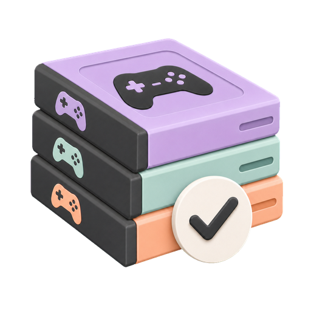
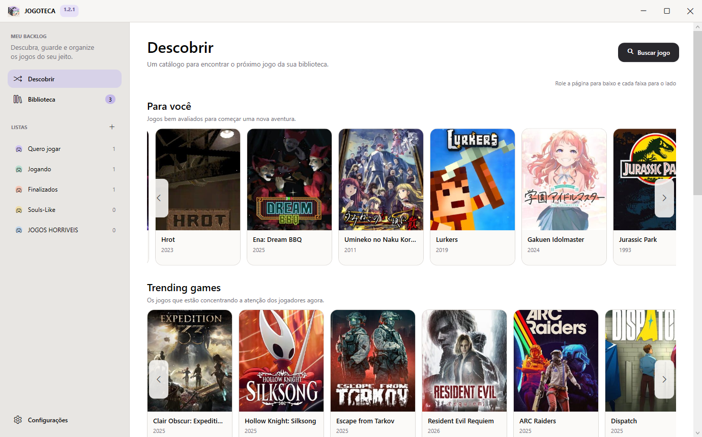
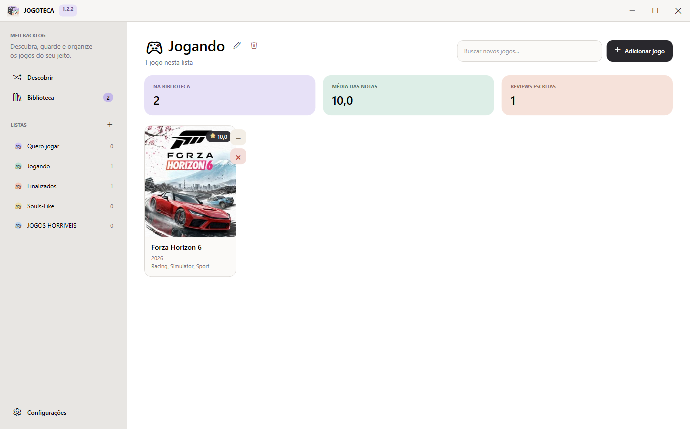

<div align="center">



# JOGOTECA

**Seu backlog de jogos, finalmente organizado.**

Descubra lançamentos, monte suas listas e acompanhe tudo o que você joga,
quer jogar e já zerou, num app bonito, rápido e 100% no seu computador.

[**⬇️ Baixar para Windows (grátis)**](https://github.com/NicolasMurtha/Jogoteca/releases/latest/download/JOGOTECA-App-win-Setup.exe)

</div>



## Por que a JOGOTECA?

Planilhas, notas no celular, prints esquecidos na galeria... A JOGOTECA junta
tudo num só lugar e transforma a pilha de jogos pendentes num catálogo que dá
vontade de abrir.

- **Descubra o que jogar** em faixas no estilo streaming: *Para você*,
  *Trending*, *Mais aguardados*, *Próximos lançamentos* e *Últimos lançamentos*.
- **Organize como um kanban:** arraste os jogos entre listas como *Quero
  jogar*, *Jogando* e *Finalizados*, ou crie as suas com nome, emoji e cor.
- **Saiba quanto tempo vai levar:** tempo estimado para zerar cada jogo.
- **Compare opiniões:** veja a nota do público ao lado da sua nota pessoal.
- **Registre sua jornada:** dê nota de 0 a 10, escreva reviews e marque as
  datas de início e de término.
- **Não perca lançamentos:** a JOGOTECA avisa quando um jogo da sua
  biblioteca é lançado.
- **Tema claro e escuro**, para jogar de dia ou de madrugada.
- **Backup em um clique:** salve a biblioteca inteira, com capas, em um único
  arquivo e restaure quando quiser, inclusive em outro computador.
- **Leve seus dados com você:** exporte a biblioteca para CSV quando quiser.



## Seus dados são seus

- **Sem conta e sem nuvem:** tudo fica salvo no seu computador.
- **Nada se perde:** antes de restaurar um backup, a JOGOTECA guarda uma cópia
  da biblioteca atual.
- **Funciona offline:** biblioteca, listas e cadastro manual não precisam de
  internet.
- **Chaves de API protegidas** pela criptografia do próprio Windows.

## Como começar

1. [Baixe o instalador](https://github.com/NicolasMurtha/Jogoteca/releases/latest/download/JOGOTECA-App-win-Setup.exe).
2. Execute o `JOGOTECA-App-win-Setup.exe`. A JOGOTECA é instalada em segundos,
   sem pedir permissão de administrador, e ganha atalhos na área de trabalho e
   no menu Iniciar.
3. Pronto! Comece adicionando jogos manualmente, só o nome já basta.

A JOGOTECA se atualiza sozinha: quando sair uma versão nova, ela avisa e
instala com um clique. Prefere não instalar? Use o
[arquivo portátil](https://github.com/NicolasMurtha/Jogoteca/releases/latest/download/JOGOTECA-App-win-Portable.zip).

> Se o Windows mostrar o aviso *"O Windows protegeu o computador"*, clique em
> **Mais informações** e depois em **Executar assim mesmo**.

### Catálogo online (opcional)

Para buscar jogos e ver capas, notas, tempos e lançamentos, conecte uma fonte
de dados gratuita em **Configurações**:

- **IGDB:** crie um *Client ID* e um *Client Secret* seguindo
  [este guia](https://api-docs.igdb.com/#account-creation).
- **RAWG:** crie uma chave em [rawg.io/apidocs](https://rawg.io/apidocs).

Com as duas configuradas, a JOGOTECA usa o IGDB e recorre ao RAWG
automaticamente quando precisar.

## Apoie a JOGOTECA 💜

A JOGOTECA é e continuará **gratuita**. Se ela te ajuda a organizar seus jogos,
considere apoiar com um [Pix de qualquer valor](https://nubank.com.br/cobrar/sj3lc/6aee81d8-0eec-4b0c-bbee-c28cf971d22f).

Quem apoia ganha:

- **Acesso antecipado** às novas versões, antes de todo mundo.
- **Contato direto comigo** para tirar dúvidas, sugerir ideias e novas
  funcionalidades ou falar sobre qualquer assunto.

Depois do Pix, é só mandar o comprovante pelo
[WhatsApp](https://wa.me/5516993827602?text=Ol%C3%A1!%20Vim%20pela%20JOGOTECA.).
O botão **Apoiar**, no topo do app, leva aos mesmos lugares.

## Para desenvolvedores

Feita em WPF com .NET 10 e SQLite.

```powershell
powershell -ExecutionPolicy Bypass -File .\build.ps1
```

O script executa os testes e gera o executável em
`dist\JOGOTECA-win-x64\JOGOTECA.exe`. Requer o SDK do .NET 10 no Windows.

Os dados ficam em `%LOCALAPPDATA%\JOGOTECA`. Instalações antigas continuam
usando `%LOCALAPPDATA%\Ludoteca` automaticamente, sem perder nada.

---

<div align="center">
<sub>Dados de jogos fornecidos por <a href="https://www.igdb.com/">IGDB</a> e <a href="https://rawg.io/">RAWG</a>.</sub>
</div>
